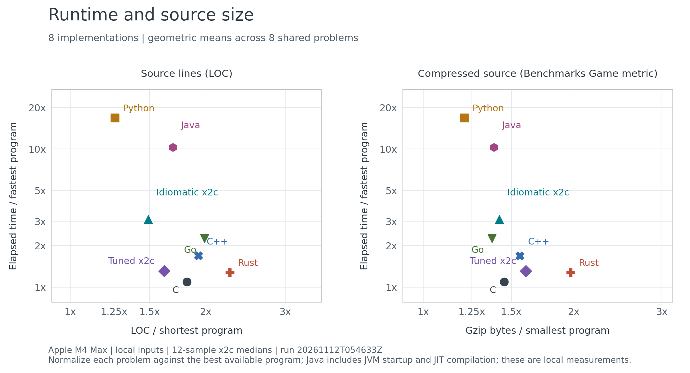

# Current benchmark results

[Score history](history.md) | [Full results table](current.md) | [Structured data](current.json) | [Summary chart](charts/runtime-source-size.svg) | [Per-problem profiles](charts/implementation-profiles.svg) | [Runtime and source-size distributions](charts/runtime-loc-distributions.svg)



## Latest local measurement

Run **20261112T054633Z**, measured on **2026-11-12 UTC**, uses the local
Apple M4 Max profile. All twenty x2c programs were checked and measured with
twelve fresh processes each after one warmup. The measured source revision is
`ccc7e475869cf93f91637f283761a57dfd92715b`. The receipt records a documentation-only
working-tree change to the suite README; all executable sources match that revision.

Across the eight shared problems, tuned x2c takes **1.20x C elapsed time**
and **1.02x Rust elapsed time**, using geometric means of matched workload
ratios. Foreign measurements remain pinned to calibration
`c19b66401dd2c0c9`; they were not rerun with x2c. These are comparisons of
selected programs, not general language rankings. Java includes fresh-JVM
startup and JIT compilation. The full canonical-size suite remains unrun.

Tuned spectral-norm now uses 61 source lines instead of 104. It shares one
row-range kernel between serial and threaded execution and uses ordinary
`Thread.run` jobs. In this complete local run, spectral-norm takes 6.314 ms
for tuned x2c and 17.737 ms for idiomatic x2c. This snapshot is not a paired
before/after experiment; timing differences from older runs also reflect
compiler and measurement-environment changes.

Across the shared cohort, tuned uses **0.892x C source lines** and
**1.105x C normalized gzip bytes**, using geometric means. Across all ten
problems, tuned source totals 727 lines, down from 770 in the prior snapshot.

## Files in this snapshot

This directory holds the promoted snapshot: the report, all three charts in
PNG/SVG/PDF, plotted measurements and summaries in CSV, and chart provenance.
[Score history](history.md) retains compact headline ratios from published
runs, with [structured history](history.json) for all language scores,
cohorts and calibration identities. The provenance records the measured revision, run ID, and report hash.

- [Summary PDF](charts/runtime-source-size.pdf)
- [Measurements CSV](charts/measurements.csv) and [summary CSV](charts/summaries.csv)
- [Chart provenance](charts/provenance.json), including the report SHA-256
- [Original run archive, profiles, raw samples and source audits](https://github.com/gwf/x2c/tree/a9aeff5b843878fd102b31402a522d2f0a1d2d6c/examples/shootout/results/runs/20261101T204543Z)


## Refresh the promoted snapshot

`make shoot-run` records scratch measurements under ignored
`examples/build/shootout/`. It leaves this published snapshot intact.
`make shoot-update` promotes the new report to `current.json` and `current.md`
in this directory and retains its summary scores in `history.json` and
`history.md`. Previous score rows remain when the current report is replaced.
Scratch build cleanup does not remove these files.

Render the promoted report without running benchmarks:

```sh
python3 examples/shootout/tools/render-charts.py \
  examples/shootout/results/current.json \
  examples/shootout/results/charts
```

The optional plotting dependencies are pinned in
[requirements-charts.txt](../tools/requirements-charts.txt). Keep the existing
single renderer; do not copy it into each saved result directory.

After an update, regenerate the figures and commit the report and charts
together. Check that `charts/provenance.json` names the same run ID and
report SHA-256. The [suite guide](../README.md) describes measurement,
calibration and reference coverage.
