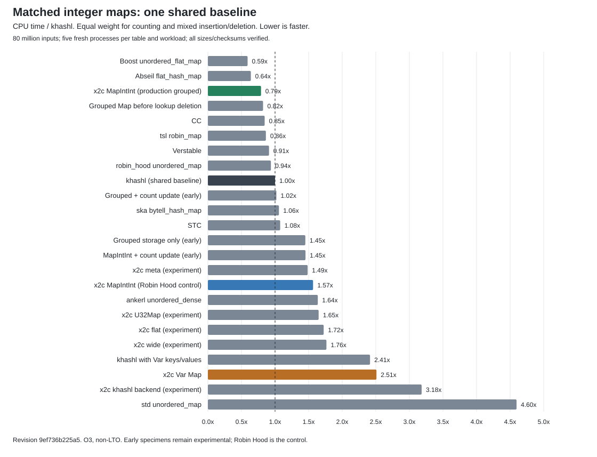

# Grouped typed Map adoption: full benchmark rerun

Measured candidate `9ef736b225a5c3f0e6400fb30d05f71ed87a172e` integrates the dev repairs at `d211420b4`. Grouped storage is the default in this candidate for all five typed families. Var Map and Pool retain Robin Hood storage. The Robin Hood typed control replaces only typed-map and substring-map objects in the same runtime. Other runtime fixes are identical.

Runtime adoption was published to `dev` at `9ef736b225a5c3f0e6400fb30d05f71ed87a172e`.
Raw measurements, binaries and source snapshots remain in the local ignored
`debug/grouped-map-adoption/benchmarks/` archive. Links below refer to that
archive; a fresh clone does not contain those local artifacts. The shared
chart and its aggregate data are committed beside this report.

## Headlines

- Adopted MapIntInt / fastest table: **1.34x CPU time** across the two matched integer workloads.
- Var Map / adopted MapIntInt: **3.17x CPU time**.
- Robin Hood typed control / fastest table: **2.65x CPU time**.

Each of 24 implementations processes the identical 80-million-input counting and mixed insertion/deletion streams. Five fresh processes per table/workload run in rotated order. All eleven checkpoint sizes and checksums match. The score is the equal-weight geometric mean of median CPU ratios to khashl. Lower is faster. Every implementation, including the complete private x2c runtime, uses O3/DNDEBUG without LTO; C++ uses C++20. Tables retain native hash and load policies. These are complete-container integer workload ratios, not universal ratios or isolated boxing costs.

| Implementation | CPU / khashl | Count ns/input | Mixed ns/input |
|---|---:|---:|---:|
| Boost unordered_flat_map | 0.591 | 15.20 | 21.30 |
| Abseil flat_hash_map | 0.640 | 15.60 | 24.30 |
| x2c MapIntInt (production grouped) | 0.791 | 20.20 | 28.70 |
| Grouped Map before lookup deletion | 0.821 | 21.40 | 29.20 |
| CC | 0.845 | 20.30 | 32.60 |
| tsl robin_map | 0.864 | 19.90 | 34.70 |
| Verstable | 0.910 | 22.90 | 33.50 |
| robin_hood unordered_map | 0.938 | 24.70 | 33.00 |
| khashl (shared baseline) | 1.000 | 22.10 | 41.90 |
| Grouped + count update (early) | 1.020 | 32.20 | 29.90 |
| ska bytell_hash_map | 1.058 | 23.60 | 43.90 |
| STC | 1.076 | 27.30 | 39.30 |
| Grouped storage only (early) | 1.451 | 68.40 | 28.50 |
| MapIntInt + count update (early) | 1.453 | 35.50 | 55.10 |
| x2c meta (experiment) | 1.485 | 38.70 | 52.80 |
| x2c MapIntInt (Robin Hood control) | 1.566 | 40.70 | 55.80 |
| ankerl unordered_dense | 1.637 | 36.10 | 68.70 |
| x2c U32Map (experiment) | 1.649 | 38.50 | 65.40 |
| x2c flat (experiment) | 1.724 | 39.10 | 70.40 |
| x2c wide (experiment) | 1.765 | 40.40 | 71.40 |
| khashl with Var keys/values | 2.414 | 58.60 | 92.10 |
| x2c Var Map | 2.510 | 86.30 | 67.60 |
| x2c khashl backend (experiment) | 3.182 | 80.50 | 116.50 |
| std unordered_map | 4.596 | 79.80 | 245.10 |

Adjusted peak memory is the upstream high-water difference above its pre-test baseline, in decimal MB. Total process RSS is retained separately in MiB. Both remain in [time/memory table](../../../../debug/grouped-map-adoption/benchmarks/map-summary.tsv) and [raw samples](../../../../debug/grouped-map-adoption/benchmarks/matched-maps/results.json). Memory is not included in the time score.

## Direct operations

Medians in elapsed ns/operation. Nine rotated processes at each of six table sizes verify the khashl partner checksum.

| Size / operation | Robin Hood control | Preceding experiment | Adopted grouped |
|---|---:|---:|---:|
| 8192 / update-add-hit | 7.660 | 3.815 | 3.693 |
| 32768 / lookup-hit | 5.806 | 3.586 | 3.403 |
| 1048576 / grow-insert | 33.913 | 17.274 | 17.076 |

## End-to-end word count

All four paths include key construction and run on each of three byte-identical inputs. Eight fresh processes per path/input/backend follow one discarded warmup. Every complete output dictionary equals Python Counter. Pipeline time includes file loading and counting; output and verification follow timing. Memory is process peak immediately after counting, in MiB.

| Input / path | Control ms | Grouped ms | Control MiB | Grouped MiB |
|---|---:|---:|---:|---:|
| repeated / var | 52.608 | 51.010 | 14.078 | 14.094 |
| repeated / typed | 37.358 | 35.578 | 14.094 | 14.109 |
| repeated / add-substr | 25.873 | 21.166 | 14.094 | 14.109 |
| repeated / sub-map | 28.538 | 22.151 | 14.062 | 14.094 |
| distinct / var | 27.258 | 27.310 | 41.250 | 41.266 |
| distinct / typed | 24.510 | 23.248 | 41.266 | 39.312 |
| distinct / add-substr | 26.983 | 24.780 | 41.266 | 39.312 |
| distinct / sub-map | 15.180 | 10.363 | 29.469 | 28.875 |
| book / var | 19.989 | 19.577 | 4.391 | 4.406 |
| book / typed | 14.046 | 12.623 | 4.406 | 4.375 |
| book / add-substr | 11.207 | 8.932 | 4.406 | 4.375 |
| book / sub-map | 11.044 | 8.502 | 4.172 | 4.203 |

## String and LongDouble

All four full Jackson profiles completed: integer matched/fixed-policy and String matched/fixed-policy. The canonical profiles compile drivers at O3 against the shipped O2 runtime. The seeded paired String comparison below uses fully O3 backends, six rotated fresh processes and fourteen internal trials with two extremes removed at each end.

| Seeded String ns/op | Control | Preceding experiment | Grouped |
|---|---:|---:|---:|
| insert_nonexisting | 67.070 | 52.288 | 51.827 |
| replace_existing | 25.833 | 25.579 | 25.015 |
| lookup_existing | 19.840 | 17.779 | 16.627 |
| lookup_nonexisting | 21.258 | 13.904 | 13.096 |

MapLongDouble uses the same native calls and deterministic long keys. Seven paired processes verify exact double sums.

| Entries / operation | Control ns/op | Grouped ns/op | Grouped/control |
|---|---:|---:|---:|
| 8192 / grow_ns | 28.809 | 15.625 | 0.542 |
| 8192 / update_ns | 7.683 | 4.745 | 0.618 |
| 8192 / lookup_ns | 6.104 | 2.907 | 0.476 |
| 32768 / grow_ns | 29.053 | 15.228 | 0.524 |
| 32768 / update_ns | 8.709 | 5.156 | 0.592 |
| 32768 / lookup_ns | 6.838 | 3.164 | 0.463 |
| 1048576 / grow_ns | 34.245 | 18.244 | 0.533 |
| 1048576 / update_ns | 13.005 | 9.715 | 0.747 |
| 1048576 / lookup_ns | 9.122 | 5.495 | 0.602 |

## c2x2c

All eight x2c versions and native C run on identical retained file/directory inputs, with five samples and independent top-ten verification. Both runtimes use O2. CPU includes waited children; wall time and peak memory remain separate.

| Backend / input / version | CPU ms | Wall ms | MiB | CPU/C | Wall/C |
|---|---:|---:|---:|---:|---:|
| grouped / file / V0 | 3.696 | 4.382 | 1.47 | 1.000 | 1.000 |
| grouped / file / V1 | 3.882 | 4.559 | 2.12 | 1.050 | 1.040 |
| grouped / file / V2 | 4.293 | 4.961 | 2.94 | 1.162 | 1.132 |
| grouped / file / V3 | 3.826 | 4.492 | 2.94 | 1.035 | 1.025 |
| grouped / file / V4 | 3.657 | 4.278 | 2.91 | 0.989 | 0.976 |
| grouped / file / V5 | 3.497 | 4.135 | 2.89 | 0.946 | 0.944 |
| grouped / file / V6 | 4.449 | 5.120 | 3.38 | 1.204 | 1.168 |
| grouped / file / V7 | 4.472 | 5.123 | 3.44 | 1.210 | 1.169 |
| grouped / file / V8 | 4.530 | 5.234 | 3.44 | 1.226 | 1.194 |
| grouped / directory / V0 | 32.720 | 33.418 | 3.14 | 1.000 | 1.000 |
| grouped / directory / V6 | 26.215 | 27.036 | 13.34 | 0.801 | 0.809 |
| grouped / directory / V7 | 31.786 | 12.398 | 14.61 | 0.971 | 0.371 |
| grouped / directory / V8 | 30.783 | 12.318 | 14.78 | 0.941 | 0.369 |
| control / file / V0 | 3.941 | 4.759 | 1.47 | 1.000 | 1.000 |
| control / file / V1 | 4.044 | 4.959 | 2.12 | 1.026 | 1.042 |
| control / file / V2 | 4.299 | 5.057 | 2.94 | 1.091 | 1.063 |
| control / file / V3 | 3.892 | 4.571 | 2.94 | 0.988 | 0.960 |
| control / file / V4 | 4.115 | 4.800 | 2.92 | 1.044 | 1.009 |
| control / file / V5 | 4.173 | 4.823 | 2.91 | 1.059 | 1.014 |
| control / file / V6 | 5.118 | 5.851 | 3.47 | 1.299 | 1.229 |
| control / file / V7 | 5.024 | 5.715 | 3.52 | 1.275 | 1.201 |
| control / file / V8 | 5.072 | 5.897 | 3.52 | 1.287 | 1.239 |
| control / directory / V0 | 32.580 | 33.486 | 3.14 | 1.000 | 1.000 |
| control / directory / V6 | 30.446 | 31.415 | 13.42 | 0.934 | 0.938 |
| control / directory / V7 | 36.811 | 14.436 | 14.86 | 1.130 | 0.431 |
| control / directory / V8 | 35.966 | 14.555 | 14.83 | 1.104 | 0.435 |

## Notes

Mutex Notes and Go run lookup/update at 1/64 clients. The three-server lookup compares mutex, database-thread and Go at 64 clients. All use the same 1,000-row fixtures, pinned SQLite, durability and logging settings, one-second warmup, five-second samples and five rounds.

[notes-http results](../../../../debug/grouped-map-adoption/benchmarks/notes-http-notes-http-191401-1/comparison.json)

| Workload | Clients | Server | Requests/s | p50 us | p99 us | Peak MiB |
| --- | ---: | --- | ---: | ---: | ---: | ---: |
| lookup | 1 | x2c | 28032.5 | 36.0 | 44.0 | 4.1 |
| lookup | 1 | go | 26335.6 | 37.0 | 51.0 | 19.2 |
| lookup | 64 | x2c | 70439.9 | 893.0 | 4053.0 | 11.3 |
| lookup | 64 | go | 68280.4 | 1072.0 | 2154.0 | 22.9 |
| update | 1 | x2c | 2506.7 | 242.0 | 596.0 | 5.9 |
| update | 1 | go | 2471.8 | 237.0 | 346.0 | 19.8 |
| update | 64 | x2c | 1493.4 | 12655.0 | 538314.0 | 15.4 |
| update | 64 | go | 1541.4 | 12966.0 | 242629.0 | 22.3 |

[notes-architectures results](../../../../debug/grouped-map-adoption/benchmarks/notes-architectures-notes-architectures-191822-1/comparison.json)

| Server | Requests/s | p99 us | Peak MiB | Lifetime cores |
|---|---:|---:|---:|---:|
| mutex | 68736.9 | 3867.0 | 11.38 | 2.93 |
| database_thread | 84380.8 | 902.0 | 11.38 | 4.58 |
| go | 67117.8 | 2198.0 | 22.81 | 3.41 |

Thread/Task in-process runs exclude sockets and HTTP; report separately.

| Clients / mode | Requests/s | CPU us/request | p99 us | Peak MiB |
|---|---:|---:|---:|---:|
| 1 / thread | 54584.3 | 18.242 | 29.0 | 8.09 |
| 1 / task | 54798.7 | 18.143 | 27.0 | 8.11 |
| 8 / thread | 120759.6 | 19.905 | 110.0 | 15.33 |
| 8 / task | 157023.8 | 12.500 | 77.0 | 20.67 |
| 64 / thread | 120473.7 | 20.765 | 715.0 | 19.59 |
| 64 / task | 156585.9 | 12.590 | 599.0 | 23.11 |

## PLSO, runtime, compiler and build cost

Official PLSO validates ten outputs and runs both x2c columns with twelve samples and one warmup. Foreign reference columns remain pinned. Paired elapsed geometric means against the preceding 255de641f run are idiomatic: 0.998x, tuned: 0.968x. These elapsed changes combine runtime/compiler/program and host effects.

[plso raw log](../../../../debug/grouped-map-adoption/benchmarks/plso.log)

[runtime raw log](../../../../debug/grouped-map-adoption/benchmarks/runtime.log)

[compiler raw log](../../../../debug/grouped-map-adoption/benchmarks/compiler.log)

[former-shootout raw log](../../../../debug/grouped-map-adoption/benchmarks/former-shootout.log)

[runtime parsed observations](../../../../debug/grouped-map-adoption/benchmarks/runtime.json)

[compiler parsed observations](../../../../debug/grouped-map-adoption/benchmarks/compiler.json)

[build cost log](../../../../debug/grouped-map-adoption/benchmarks/build-cost-quiet-183409-1.log); [Match-cache acceptance](../../../../debug/grouped-map-adoption/benchmarks/match-cache-192347-1.log). The publication gate supplies stage-build and self-host comparisons; those correctness checks were not repeated merely for timing. The build-cost score is 60.073% of baseline, from 42.989121 child CPU seconds / 99,743 authored lines. The preceding 255de641f snapshot scored 55.676%, from 39.666729 seconds / 99,303 lines. A targeted quiet repeat scored 61.320%, from 43.881925 child CPU seconds over the same 99,743 lines, with no detected compiler overlap. This cross-revision increase includes the intervening compiler repairs; it is not an isolated Map-backend comparison. Stage-0 translation is 3.448 s versus 3.446 s previously; stage 1 is 2.068 s versus 1.960 s. No aggregate mixes instruction counts, CPU and wall time.

## Verification and measurement limits

The integrated focused suites pass 81 tests and 5,455 assertions in normal, forced-scalar, Rosetta x86_64 and sanitizer configurations. Each also passes two million independent dictionary operations plus complete traversal and key verification. The full native suite passes 1,163 tests and 103,688 assertions. Rosetta is emulated x86_64 evidence; Docker was unavailable, so Linux/GCC was not rerun.

The main quiet window was released immediately after all 15 campaign steps. The targeted build-cost confirmation ran afterward; both previously coordinated chats had archived and could not receive a renewed request. Its guard detected no compiler overlap. The quiet window was coordinated with other agents before timing. Families run sequentially. Four matched attempts overlapped outside x2c activity and were excluded; all 240 accepted matched samples and 468 accepted profile samples have no detected compiler overlap. Other agents confirmed their builds were held; the source of the outside activity was not identified. Every guarded sample/step retains overlap evidence and discarded attempts. The desktop remains shared with ordinary interactive applications. No universal or zero-noise claim follows from these measurements.

[source/binary metadata](../../../../debug/grouped-map-adoption/benchmarks/maps/build.json); [attempts](../../../../debug/grouped-map-adoption/benchmarks/extended-status.json); [raw profiles](../../../../debug/grouped-map-adoption/benchmarks/map-profiles/results.json).

[direct raw output](../../../../debug/grouped-map-adoption/benchmarks/canonical-hash/direct)

[jackson-matched raw output](../../../../debug/grouped-map-adoption/benchmarks/canonical-hash/jackson-matched)

[jackson-fixed-policy raw output](../../../../debug/grouped-map-adoption/benchmarks/canonical-hash/jackson-fixed-policy)

[jackson-string raw output](../../../../debug/grouped-map-adoption/benchmarks/canonical-hash/jackson-string)

[jackson-string-fixed-policy raw output](../../../../debug/grouped-map-adoption/benchmarks/canonical-hash/jackson-string-fixed-policy)
